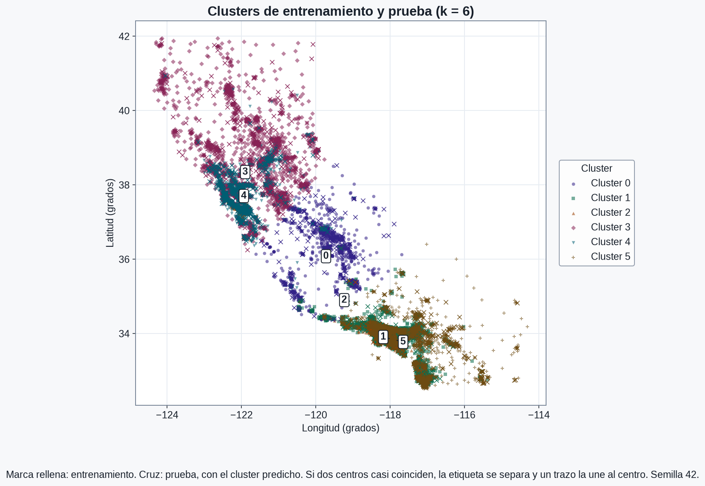
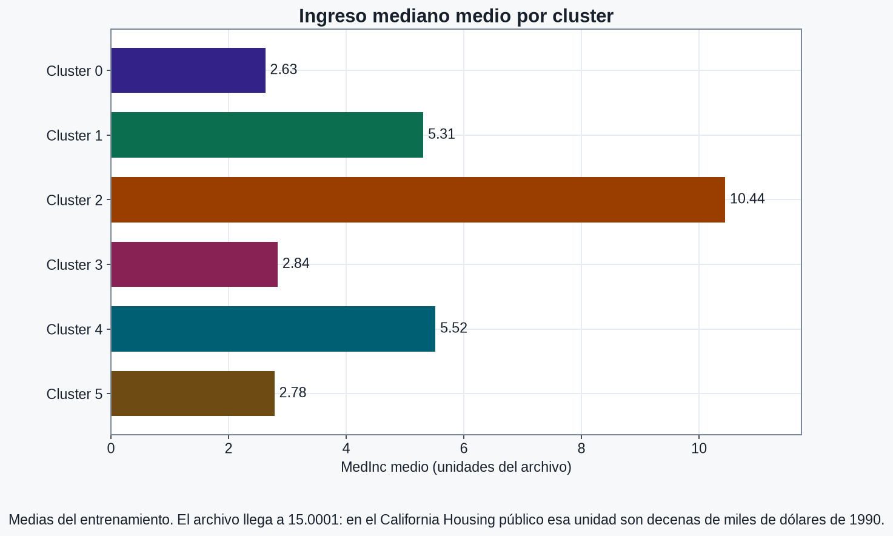
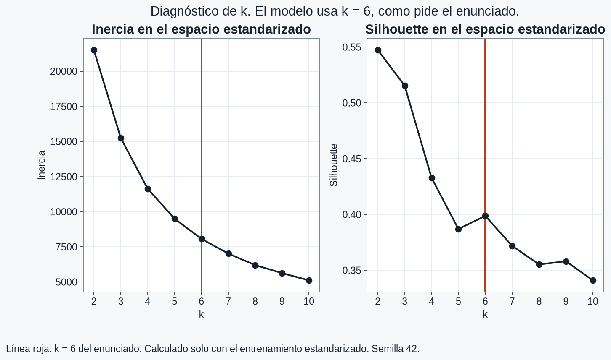
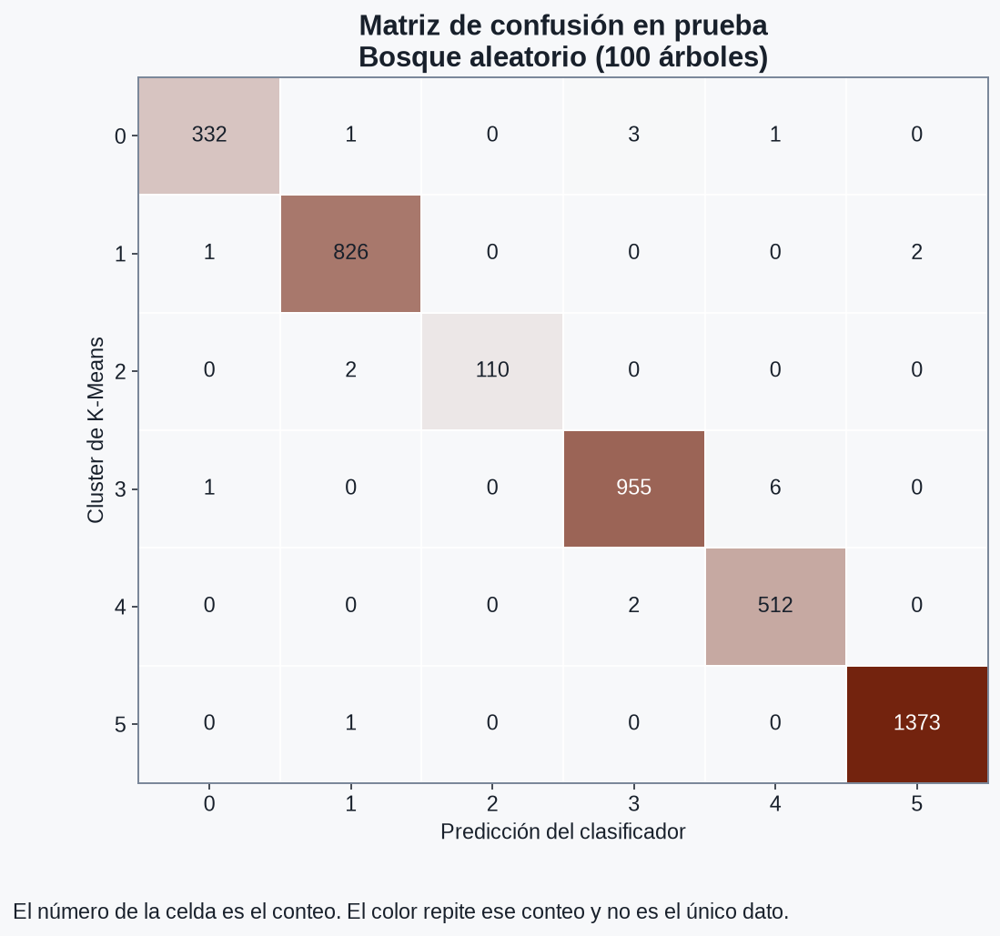

# Agrupación de viviendas en California

Clasifica grupos de bloques del censo de California de 1990 por región e ingreso mediano. El enunciado pide K-Means con 6 clusters sobre `Latitude`, `Longitude` y `MedInc`, una predicción en el conjunto de prueba, un clasificador supervisado entrenado con esas etiquetas y los dos modelos guardados.

## Cómo correrlo

Desde la raíz del repositorio, con Python 3.11 o superior:

```bash
pip install pandas numpy scikit-learn matplotlib joblib pytest jupyter nbconvert ipykernel
python src/app.py
python src/housing_clusters.py
python -m pytest -q
jupyter nbconvert --to notebook --execute --inplace src/explore.ipynb
```

`python src/app.py` vuelve a entrenar y escribe los modelos, las figuras y `reports/evaluation.json`. El paso 3 del enunciado añade `cluster` al DataFrame en memoria; no pide versionar ese dataset. Para regenerar el CSV local:

```bash
python src/housing_clusters.py
```

Ese comando repite el ajuste y escribe `data/processed/housing_with_cluster.csv`. Esa ruta está en `.gitignore`. No hace falta `DATABASE_URL`: `src/utils.py` conserva el conector de la plantilla y este caso no lo llama.

El ajuste que está guardado se hizo con Python 3.12.3, scikit-learn 1.9.1 y pandas 3.1.1. La semilla es 42 y el álgebra lineal va a un hilo (`OMP_NUM_THREADS=1` dentro del módulo).

`requirements.txt` es el de la plantilla y no se modificó. Incluye OpenCV, XGBoost y Postgres, que este caso no importa.

## Datos

Copia local de <https://raw.githubusercontent.com/4GeeksAcademy/k-means-project-tutorial/main/housing.csv>.

| | |
| --- | --- |
| Ruta | `data/raw/housing.csv` |
| Bytes | 1959699 |
| sha256 | `0e4a0bc8b337d88c95259a8ec05a58c662f26f87487f9cbf2448fe93207bcb5c` |
| Filas | 20640 |
| Columnas del archivo | `MedInc`, `HouseAge`, `AveRooms`, `AveBedrms`, `Population`, `AveOccup`, `Latitude`, `Longitude`, `MedHouseVal` |
| Columnas del modelo, en este orden | `Latitude`, `Longitude`, `MedInc` |

No hay valores ausentes en esas tres columnas. El resto del archivo no entra en el ajuste.

División: 80 % entrenamiento (16512 filas) y 20 % prueba (4128), con `train_test_split`, `shuffle=True` y `random_state=42`. El enunciado no fija el porcentaje.

## Clusters

K-Means con `n_clusters=6`, `n_init=10`, `algorithm="lloyd"` y `random_state=42`. Antes de la distancia euclídea, un `StandardScaler` se ajusta solo con el entrenamiento. En ese conjunto la desviación típica es 2.14 en latitud, 2.01 en longitud y 1.90 en MedInc: las cifras se parecen, las unidades no.

La predicción de K-Means llega como `int32` con valores 0–5. En el DataFrame en memoria la columna `cluster` es categórica con esas seis categorías. El CSV local, si se regenera, guarda el entero y la columna `split`, porque un CSV no conserva el dtype de pandas.



La marca rellena es una vivienda de entrenamiento y la cruz es una vivienda de prueba con el cluster predicho. El número identifica el cluster. Si dos centros casi coinciden, la etiqueta se aparta y un trazo la une al centro. El mapa usa grados con el mismo aspecto en los dos ejes, sin proyección. La forma que se dibuja es California; longitud más baja es más al oeste.

El grupo más al norte es el 3 (latitud media 38.35, longitud −121.90, MedInc 2.84, 3931 viviendas de entrenamiento). El más al sur y el más al este es el 5 (latitud 33.82, longitud −117.82, MedInc 2.78). El más al oeste es el 4 (longitud −121.94).

En el mapa hay pares que ocupan la misma zona y se separan por ingreso, porque MedInc entra en la distancia y el gráfico no lo muestra:

| Cluster | Entrenamiento | Prueba | Latitud | Longitud | MedInc medio |
| --- | ---: | ---: | ---: | ---: | ---: |
| 0 | 1321 | 337 | 36.08 | −119.73 | 2.63 |
| 1 | 3380 | 829 | 33.87 | −118.02 | 5.31 |
| 2 | 453 | 112 | 34.90 | −119.24 | 10.44 |
| 3 | 3931 | 962 | 38.35 | −121.90 | 2.84 |
| 4 | 2239 | 514 | 37.70 | −121.94 | 5.52 |
| 5 | 5188 | 1374 | 33.82 | −117.82 | 2.78 |

Los centros de 1 y 5 están a 0.21 grados (MedInc 5.31 y 2.78). Los de 3 y 4 están a 0.65 grados (MedInc 2.84 y 5.52). El cluster 2 es el más pequeño y el de mayor ingreso (10.44). El 0 tiene el ingreso medio más bajo (2.63). En el archivo, MedInc va de 0.4999 a 15.0001. Ese tope es el del California Housing público, en decenas de miles de dólares de 1990.



Todas las pruebas caen en clusters que ya existen. El cluster de prueba más pequeño tiene 112 viviendas. La mayor diferencia de proporción entre entrenamiento y prueba es de 1.9 puntos porcentuales, en el cluster 5. Las cruces quedan sobre las mismas nubes: la predicción no abre una región nueva.

## Diagnóstico de k

El enunciado fija k = 6. Inercia y silhouette, en el espacio estandarizado del entrenamiento y con la misma semilla, no cambian ese valor.



La inercia baja de 21504 en k = 2 a 5117 en k = 10. El mayor descenso relativo está entre k = 2 y k = 3 (29.1 %). El silhouette máximo del rango es 0.547 en k = 2. En k = 6 el silhouette es 0.399 y la inercia 8069. De k = 5 a k = 6 sube de 0.387 a 0.399 y en k = 7 baja a 0.372: es un repunte local, no el máximo.

## Clasificador

La etiqueta no venía en el censo: la crea K-Means. El clasificador aprende a repetir ese número a partir de las mismas tres columnas. La métrica cuenta cuántas etiquetas de cluster acierta. MedHouseVal queda fuera del ajuste.

Comparación en el entrenamiento, F1 macro, validación cruzada estratificada de 5 pliegues, semilla 42. El conjunto de prueba no entra en la elección. Si el F1 medio empata, gana la menor desviación y después el modelo más simple de esta lista: regresión logística, árbol, k vecinos, bosque.

| Modelo | F1 macro medio | Desviación |
| --- | ---: | ---: |
| Regresión logística | 0.983 | 0.005 |
| Árbol de decisión | 0.987 | 0.004 |
| k vecinos más cercanos (15) | 0.984 | 0.003 |
| Bosque aleatorio (100 árboles) | 0.990 | 0.001 |

La regla de arriba guarda el bosque aleatorio. El árbol queda a 0.003.

En la prueba: exactitud 0.995, F1 macro 0.993, F1 ponderado 0.995, exactitud balanceada 0.992. El F1 más bajo es el del cluster 0 (0.990). La importancia por impureza, sin estandarizar, es Latitude 0.270, Longitude 0.256 y MedInc 0.474.



El informe completo está en `reports/classification_report.txt`.

## Modelos guardados

| Archivo | Qué es |
| --- | --- |
| `models/kmeans.joblib` | `Pipeline` con `StandardScaler` y `KMeans` (k = 6) |
| `models/supervised_classifier.joblib` | Bosque aleatorio de 100 árboles |
| `models/training_metadata.json` | Hash del dataset, semilla, k y versión de las librerías |

Los dos se vuelven a cargar al final del script y la predicción coincide con la del objeto en memoria. Para predecir, las columnas tienen que llegar como `Latitude`, `Longitude`, `MedInc`.

## Estructura

- `src/explore.ipynb` — cuaderno ejecutado, con las salidas de cada paso.
- `src/housing_clusters.py` — carga, división, K-Means, diagnóstico, comparación y figuras.
- `src/app.py` — punto de entrada.
- `src/utils.py` — conector de base de datos de la plantilla, sin uso en este caso.
- `data/raw/housing.csv` — dataset oficial, versionado.
- `data/processed/housing_with_cluster.csv` — CSV local con `cluster` y `split`. No va en el repo. Se regenera con `python src/housing_clusters.py`.
- `models/` — los dos estimadores. El paso 5 pide guardarlos aquí.
- `reports/` — métricas, lecturas y figuras.
- `tests/test_reproducibility.py` — misma semilla, mismo etiquetado; hash del CSV; k = 6; contraste de las marcas.
- `PROVENANCE.md` — commit de la plantilla y hash del dataset.

## Procedencia

La base es [machine-learning-python-template](https://github.com/4GeeksAcademy/machine-learning-python-template) en el commit `b49eff6673b76ba5b0003103e32f62a2eb9904a4`. Ese repositorio no publica licencia y el commit no trae archivo `LICENSE`. La atribución de la plantilla queda en `PROVENANCE.md`. `preview.jpg` es la imagen de la plantilla, no un resultado de este análisis.

No se usó `solution.ipynb` del tutorial.

## Gráficas

Texto en `#18202B` sobre `#FFFFFF` y `#F7F8FA` (contraste 16.4:1 y 15.4:1). Las seis marcas de cluster superan 4.5:1 sobre el fondo y, además, cada cluster tiene una forma distinta y un número. La fuente pedida es Arial o Helvetica. En la máquina que generó estos PNG no están; se usó Arimo, que es métricamente compatible con Arial y ya estaba instalada. El detalle medido está en `reports/contrast.json`.
